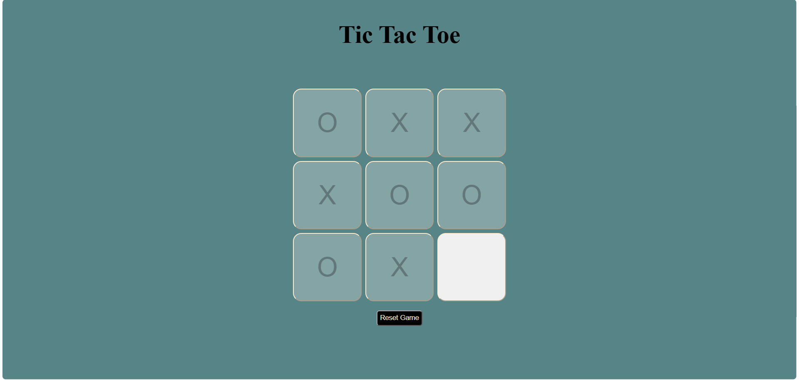
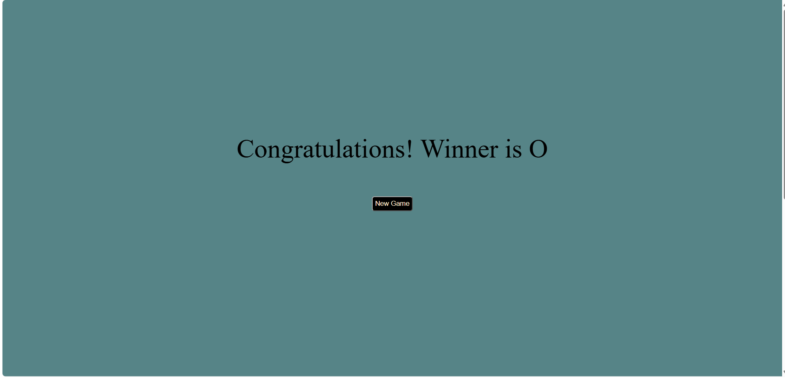

# 🎮 Tic-Tac-Toe Game

A simple, interactive Tic-Tac-Toe game built using HTML, CSS, and JavaScript.

## 📌 Project Overview

This project is a browser-based version of the classic Tic-Tac-Toe game, where two players take turns marking spaces on a 3×3 grid with X and O. The objective is to get three marks in a row, column, or diagonal to win the game.

The game uses JavaScript to manage player turns, check winning combinations, detect draws, and reset the board. HTML provides the game structure, while CSS styles the board and user interface.

This project helped me practice DOM manipulation, event handling, conditional logic, and interactive web development.

## 🎯 Features

- Two-player gameplay
- Interactive 3×3 game board
- Automatic winner detection
- Draw detection
- Reset Game functionality
- New Game option after a win

## 🛠️ Technologies Used

- HTML5
- CSS3
- JavaScript

## 🚀 How to Run

1. Clone or download this repository.
2. Open `tic-tac-toe.html` in your browser.
3. Start playing!

No additional installation is required.

## 📂 Project Structure

```text
tic-tac-toe-game/
├── tic-tac-toe.html
├── tic-tac-toe.css
├── tic-tac-toe.js
├── README.md
└── assets/
    ├── tic-tac-toe-page.png
    └── tic-tac-toe-page2.png
```

## 📸 Screenshots

### Gameplay





---

Made with ❤️ using HTML, CSS, and JavaScript.
